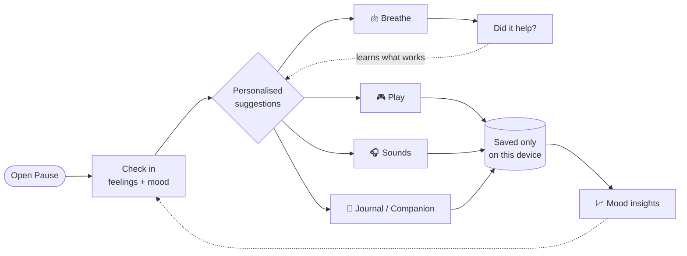

<div align="center">


# Pause – A Little Space for You

**A little space to breathe, reflect, and reconnect with yourself.**

A calm, private wellness web app: check in with your feelings, breathe, play quiet games, listen to soothing sounds, and write things down. Everything stays on your own device.


[Repository](https://github.com/nbhumika07/pause-2.0) · [Run it locally](#getting-started) · [Features](#features) · [Report an issue](https://github.com/nbhumika07/pause-2.0/issues)


</div>

---

## Contents

- [Overview](#overview)
- [Screenshots](#screenshots)
- [Features](#features)
- [Getting started](#getting-started)
- [How it works](#how-it-works)
- [Tech stack](#tech-stack)
- [Project structure](#project-structure)
- [Privacy and data](#privacy-and-data)
- [Browser support and accessibility](#browser-support-and-accessibility)
- [Contributing](#contributing)
- [Future ideas](#future-ideas)
- [License](#license)

## Overview

**Why Pause exists.** Everyday stress builds up quietly: exams, deadlines, people, too much screen time. Pause is a small place to step away for a few minutes, notice how you feel, and do one gentle thing about it.

**Who it's for.** Students and anyone who wants a quiet, low-pressure way to unwind and reflect, without signing up for anything.

**What makes it different:**

- 🔒 **Private by design.** No account, no tracking, and no app server storing your data. What you write stays in your browser.
- 🌱 **No pressure.** No streaks, scores or reminders that make you feel guilty. Stop any activity whenever you like.
- 📴 **Works offline.** After the first visit (through a local server), the app keeps working without internet.
- 🤝 **Honest about its limits.** Pause supports self-reflection. It doesn't diagnose, and it points to real help (112 and Tele-MANAS in India) when someone may need it.

## Screenshots

<table>
  <tr>
    <td width="50%"><br><sub><b>Today:</b> check-in, daily affirmation and small suggestions</sub></td>
    <td width="50%"><br><sub><b>Take a Little Break:</b> the games hub with a game of the day</sub></td>
  </tr>
  <tr>
    <td><br><sub><b>Breathe:</b> a pattern suggested for how you feel</sub></td>
    <td><br><sub><b>Sounds:</b> mix soundscapes, each with its own volume</sub></td>
  </tr>
  <tr>
    <td><br><sub><b>Mood history:</b> week, 30-day and calendar views</sub></td>
    <td><br><sub><b>Journal:</b> private entries with gentle reflection prompts</sub></td>
  </tr>
</table>

<p align="center"><br><sub>Designed mobile-first</sub></p>

## Features

### 🌡 Mood check-ins
- Describe your day on a five-step scale, from "Really heavy" to "Light and good".
- Pick from **24 feeling tags**, add a note, and optionally tick "Today I…" factors such as *time outside* or *long study day*.
- **History** shows your mood as a week or 30-day line chart, or a month calendar. Each chart has a table view, and you can edit or delete any entry.
- **Insights** summarise your week and point out possible patterns on your device, always phrased as things you *might notice*, never as causes.

### 🫁 Guided breathing
- Five patterns (longer exhale, box, even breathing, 4·7·8, double-inhale sigh) plus your own custom timing, with sessions from 1 to 10 minutes.
- **Breathing for how you feel:** pick a feeling and Pause suggests a pattern, a length and a reason. After each session it asks whether it helped, and remembers what worked for you.
- Optional soft breath sounds timed to the circle, gentle chimes, background ambience, or silence.

### 🎮 Wellness mini-games
Six quiet games, each with an intro screen, a choice of pace (Gentle, Steady or Focused), pause, restart and exit, and a calm completion screen. There are no timers, scores or penalties.

| Game | What you do |
|---|---|
| **Catch the Fireflies** | Tap glowing fireflies (or press Enter) and watch them drift into the night sky |
| **Bubble Pop** | Pop bubbles as they float upward; missed ones just drift away |
| **Fluid Art** | Paint soft colour trails, try mirror patterns, and save your picture |
| **Bubble Wrap** | Pop a sheet of bubbles, or press and drag to pop a whole row |
| **Five Senses** | A 5-4-3-2-1 grounding exercise, with optional notes you can save to your journal |
| **Alphabet Categories** | Think of a word for a letter and category; there are no wrong answers |

The games page also has a **game of the day**, recently played games, favourites, a private play history, and six short **guided moments** (two-minute start, thought dump, gentle reset, three small things, body scan, reach out).

### 🎧 Ambient audio
- **13 soundscapes generated live in your browser**, with no audio files needed: rain, distant thunder, ocean waves, forest, soft wind, night crickets, fireplace, stream, white, pink and brown noise, deep focus, and soft tones.
- Play several at once, each with its **own volume**, and they fade smoothly in and out.
- **Six presets** (such as *Rainy Evening* and *Cozy Night*), plus your own saved mixes, favourites and recently played.
- A sleep timer, adjustable fade times, a master volume, a live visualiser, and optional soft sound effects in games.

### ✨ Daily affirmations
- A new affirmation every day, chosen from **42 affirmations in 8 categories** such as Confidence, Self-compassion and Rest & calm.
- Browse by category, get one that matches your latest check-in, or write your own.
- Save favourites to come back to later.

### 📓 Journal and reflections
- Private journal entries with **daily writing prompts**, search, categories and automatic draft saving.
- **Journal assistant:** reflection questions, organise scattered thoughts into sections, summarise, find a positive takeaway, or suggest a category.
- **My Notes for Therapy:** a structured note to prepare for talking with a counsellor. It can sort a brain dump under its nine headings, and you can print it or export it as text.
- **Companion:** a supportive chat with six modes (*vent*, *understand my feelings*, *motivation*, *calm down*, *just listen*, *give me an activity*). It isn't saved unless you choose "Save to journal".

### 📚 Reading library
- **37 short, original articles** on everyday struggles such as exam stress, loneliness, overthinking and rest, plus 8 "bookshelf" reflections.
- **Smart search** (for example, "exams" also finds *academic pressure*), browse by need, reading times, and read markers.
- Bookmarks, a distraction-free reader with adjustable text size, and space to save your own takeaways.

### 🌤 Today dashboard
Your check-in, the daily affirmation, three suggestions chosen for your mood and the time you have, your week at a glance, recent journal entries, and reading progress, all on one calm page.

### 🔒 Privacy and settings
- Light, night or match-device theme, reduced motion, and personal goals and preferences.
- **Export** all your data as a JSON file, **import** a backup, or **delete** any type of data, or everything at once.

> **Optional AI (runs locally only).** The companion, journal assistant, weekly reflection, affirmations, article summaries and breathing suggestions can use an AI model, but only if you run the included local backend with your own API key, switch AI on in Settings, and accept a consent notice. AI is **off by default**, and every feature has an on-device version. Results are always labelled *AI suggestion* or *On-device suggestion*. See [Optional: AI features](#optional-ai-features).

## Getting started

### Prerequisites
- A modern browser. Pause was tested in Chromium, the engine behind Chrome and Edge.
- **One** way to run a simple local web server:
  - **Python 3**, or
  - **Node.js 18+**, which is also needed for the optional AI features.
- Git, to clone the repository.

### Installation

```bash
git clone https://github.com/nbhumika07/pause-2.0.git
cd pause-2.0
```

### Running locally

Pause is a static site, but it should be served over a local server rather than opened as a file. Browser storage, the offline cache and audio work most reliably that way.

**Option A: Python**
```bash
python -m http.server 8000
```
Then open <http://localhost:8000>.

**Option B: Node.js** (also enables the AI backend in test mode)
```bash
node backend/dev-server.js
```
Then open <http://localhost:8787>.

To stop the server, press `Ctrl + C`.

### Live demo
There's no public deployment at the moment. Run it locally with the steps above.

### Optional: AI features

1. Get an API key from a provider. For example, Google Gemini at <https://aistudio.google.com/apikey>.
2. Copy `backend/.dev.vars.example` to `backend/.dev.vars`. This file is git-ignored, so your key is never committed. Fill it in:
   ```ini
   PROVIDER=openai
   OPENAI_BASE_URL=https://generativelanguage.googleapis.com/v1beta/openai
   MODEL=your-model-name
   OPENAI_API_KEY=your-key
   ```
   Model names change over time, so check your provider's current list. Claude is also supported (`PROVIDER=anthropic`).
3. Run `node backend/dev-server.js`, open **Settings → AI assistance**, switch AI on and press **Test**.

Without a key, the backend runs in **test mode**: replies are placeholders clearly labelled "Test mode · not AI".

## How it works



**In plain terms:**

- **One page, many screens.** `index.html` loads the app once. Moving between screens (Today, Mood, Play…) swaps the content without reloading, using the part of the address after `#`.
- **JavaScript runs everything.** Each screen is a small file in `assets/js/pages/`. Shared helpers handle saving, dialogs, notifications and suggestions.
- **Sound is created, not downloaded.** The Web Audio API generates the sounds live from filtered noise, tones and tiny pre-made sound events (raindrops, crackles, bubbles, crickets). One audio engine mixes them, fades them, and uses a limiter so they never distort.
- **Your data lives in your browser.** Check-ins, journal entries, notes, bookmarks and activity history are saved in **IndexedDB**, a database built into the browser. If IndexedDB isn't available, Pause falls back to **localStorage**. Small preferences (theme, sound mix, favourites) are kept in localStorage.
- **No server needed for normal use.** The app works with just static files. The `backend/` folder is only needed for the optional AI features, and it runs on your own computer.
- **Works offline.** A service worker saves the app's files after the first visit, so it opens even without internet.

## Tech stack

| Technology | Role in Pause |
|---|---|
| **HTML5** | Page structure and semantic, accessible markup |
| **CSS3** | The design system: light and night themes, responsive layouts, animations, reduced-motion support |
| **JavaScript** (vanilla, no framework) | Screens, navigation, games, suggestions and charts |
| **Web Audio API** | Generated soundscapes, mixing, game sound effects and breathing cues |
| **IndexedDB** | Main on-device storage for check-ins, journal, notes, bookmarks and activity |
| **localStorage** | Preferences, saved sound mixes and drafts, and a fallback if IndexedDB is unavailable |
| **Canvas and SVG** | Fireflies and fluid art (Canvas); mood charts (SVG) |
| **Service worker and web app manifest** | Offline support; installable as an app |
| **Node.js** (optional) | Local server for the optional AI backend in `backend/` |

## Project structure

```text
pause-2.0/
├── index.html                # Entry point: loads styles and scripts
├── manifest.webmanifest      # App name, icons and colours (installable app)
├── sw.js                     # Service worker for offline use
├── LICENSE                   # MIT License
├── assets/
│   ├── css/styles.css        # All styling, themes and responsive layout
│   ├── icon.svg, icon-*.png  # App icons
│   └── js/
│       ├── config.js         # Public settings (AI address, optional audio files)
│       ├── core.js           # Helpers, preferences, dialogs, notifications, navigation
│       ├── storage.js        # IndexedDB storage with localStorage fallback; export/import
│       ├── catalog.js        # Content: feelings, activities, affirmations, prompts
│       ├── recommend.js      # Chooses personalised suggestions
│       ├── safety.js         # Detects crisis language and shows support options
│       ├── ai.js             # Optional AI: consent, requests and on-device fallbacks
│       ├── charts.js         # Mood charts
│       ├── games.js          # The six mini-games
│       ├── audio/            # Audio engine, 13 soundscapes and the mixer
│       ├── pages/            # One file per screen (today, mood, journal, play, …)
│       └── app.js            # App shell and navigation bar
├── data/                     # Reading library articles and bookshelf reflections
├── docs/screenshots/         # Images used in this README
└── backend/                  # Optional: local AI backend
    ├── worker.js             # Writes prompts and safety rules, calls the AI provider
    ├── dev-server.js         # Serves the app and the AI backend on localhost:8787
    └── .dev.vars.example     # Template for your private API key settings
```

**Where to start:** to add content, edit `assets/js/catalog.js` or the files in `data/`. To change a screen, edit its file in `assets/js/pages/`.

## Privacy and data

- **No account is needed**, and Pause has no analytics or tracking.
- **Your personal data stays on your device.** It's stored in your browser's IndexedDB and localStorage. It isn't uploaded anywhere and doesn't sync to other devices or browsers.
- **External requests.** Fonts load from Google Fonts. None of your entries are included in those requests. Nothing else is contacted, unless you set up and switch on the optional AI.
- **Optional AI.** When enabled, only the text for the action you choose is sent, through your own local backend, to the AI provider you configured. That provider's privacy terms apply. A consent notice explains this before anything is sent.
- **You're in control.** Go to **Settings → Your data** to export a backup, import one, or delete a single type of data or everything.
- **Good to know.** Clearing your browser's site data also deletes Pause's data, and browser storage isn't encrypted. Export a backup if you want to keep your entries.

> Pause is a self-reflection tool. It does not diagnose, provide crisis care, or replace a qualified mental-health professional. In India, call **112** in an emergency, or **Tele-MANAS** at **14416** / **1-800-891-4416** (free, 24×7) for mental-health support.

## Browser support and accessibility

**Tested in:** Chromium (the engine behind Chrome and Edge) on desktop, plus Chromium's iPhone-sized mobile emulation. Firefox and Safari use the same standard web features but haven't been tested yet. Reports are welcome.

**Accessibility:**
- **Keyboard** works throughout: a skip link, visible focus outlines, Escape to close dialogs or pause games, and Enter to release fireflies.
- **Screen readers:** headings, labels and live announcements for status messages. Mood history charts have a "View as table" option.
- **Reduced motion** follows your device setting, or can be switched on in Settings. Animations and games switch to calmer versions.
- **Responsive, mobile-first layouts** with large touch targets.
- **Light, night and match-device themes.**

**Audio notes and known limitations:**
- Browsers only allow sound after you tap or click something, so sound never starts on its own.
- On iPhone, web audio is silent when the ring/silent switch is on silent.
- Data isn't shared between browsers or devices. Use export and import to move it.

## Contributing

Contributions are welcome: bug reports, accessibility improvements, new content, and new ideas.

1. **Fork** the repository on GitHub, then clone your fork:
   ```bash
   git clone https://github.com/<your-username>/pause-2.0.git
   cd pause-2.0
   ```
2. **Create a branch** for your change:
   ```bash
   git checkout -b feature/short-description
   ```
3. **Make your changes** and test them locally (see [Running locally](#running-locally)).
4. **Commit and push:**
   ```bash
   git add .
   git commit -m "Describe your change"
   git push origin feature/short-description
   ```
5. **Open a pull request** on GitHub and describe what you changed and why.

Please keep the app calm and pressure-free: no streaks, scores or guilt-based features. Never commit API keys or `backend/.dev.vars`.

Found a problem? [Open an issue](https://github.com/nbhumika07/pause-2.0/issues).

## Future ideas

These are **possible future improvements, not current features**:

- Hosted AI, so the optional AI features work outside a local setup
- Optional accounts and encrypted cloud sync across devices
- Recorded nature soundscapes alongside the generated ones (the app can already load audio files listed in `config.js`)
- More languages, for example Hindi and Kannada
- More mini-games and guided moments
- Testing and fixes for Firefox and Safari

## License

Released under the [MIT License](LICENSE). © 2026 Bhumika N.

## Acknowledgements

- Fonts: [DM Sans](https://fonts.google.com/specimen/DM+Sans), [Manrope](https://fonts.google.com/specimen/Manrope) and [Fraunces](https://fonts.google.com/specimen/Fraunces) from Google Fonts.
- Support information from India's [112](https://112.gov.in/) emergency service and the [Tele-MANAS](https://dghs.mohfw.gov.in/national-mental-health-programme.php) programme.
- Bookshelf reflections are original writing inspired by book themes; they aren't quotations from the books.

---

<div align="center">

Made with care by [Bhumika N](https://github.com/nbhumika07) · Feedback welcome through [Issues](https://github.com/nbhumika07/pause-2.0/issues)

**Take a breath. You're doing better than you think. 🌙**

</div>
