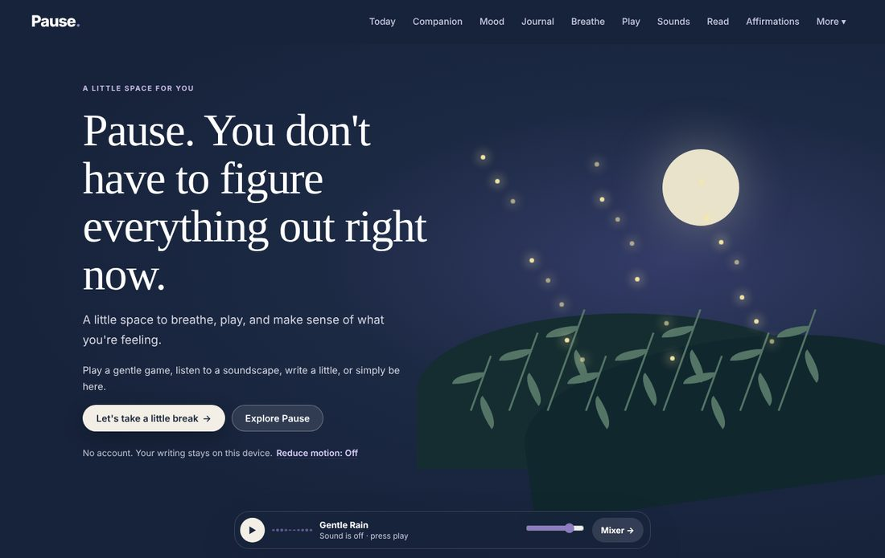
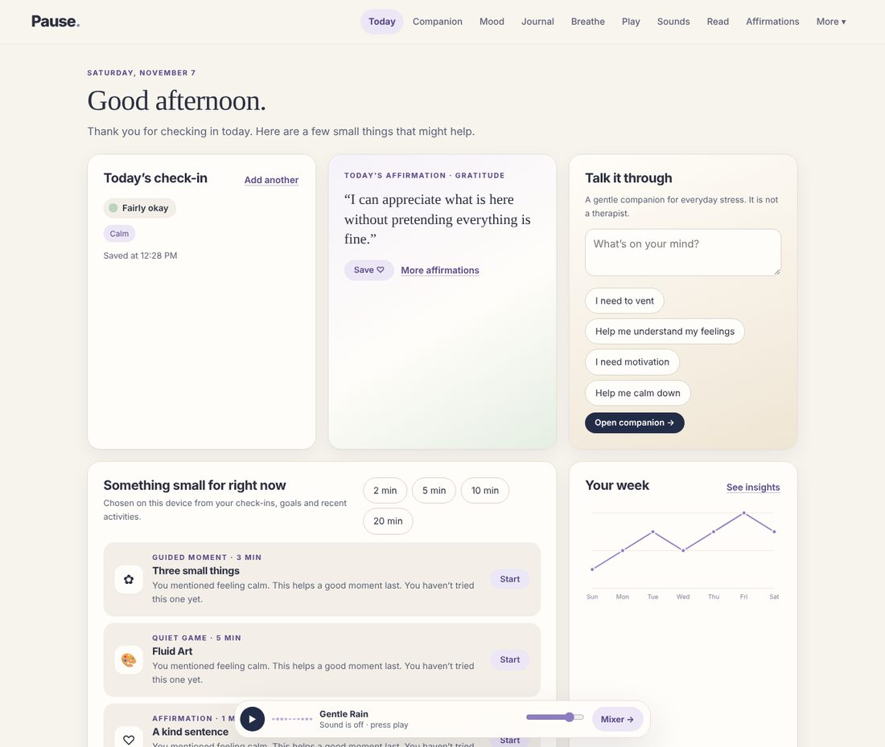
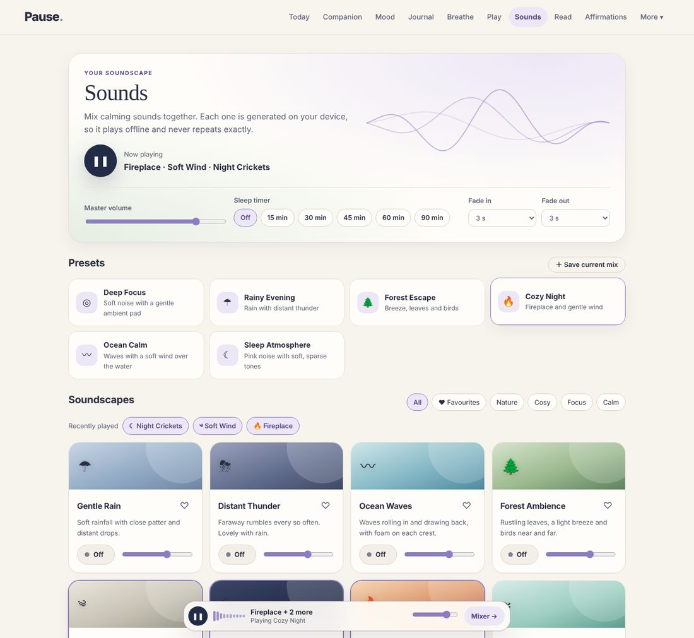
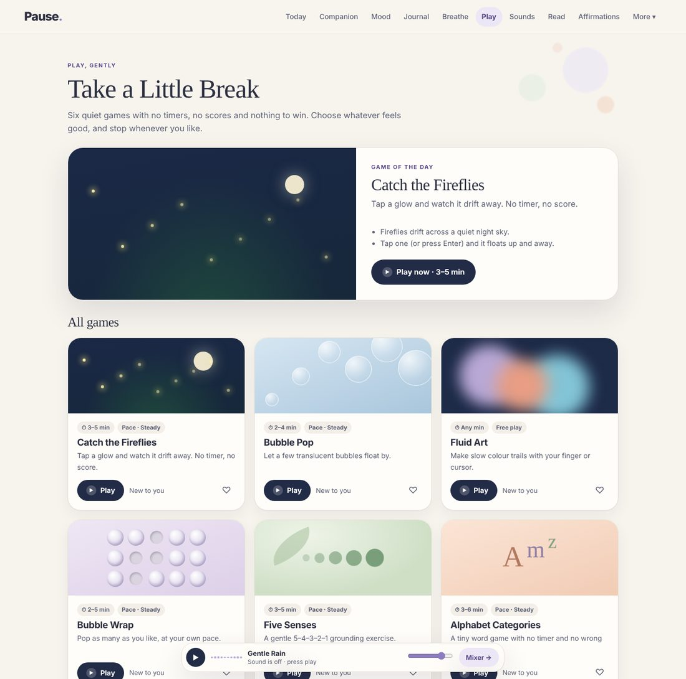
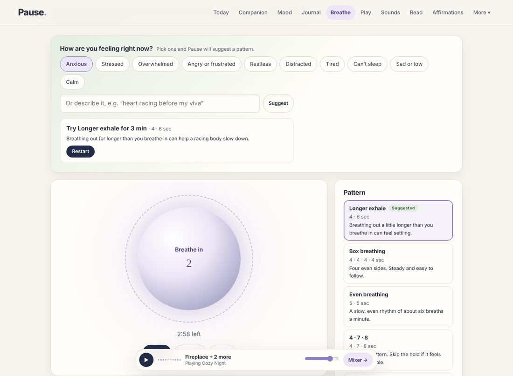
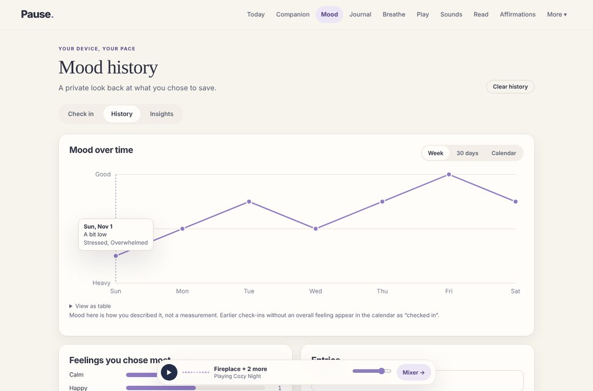
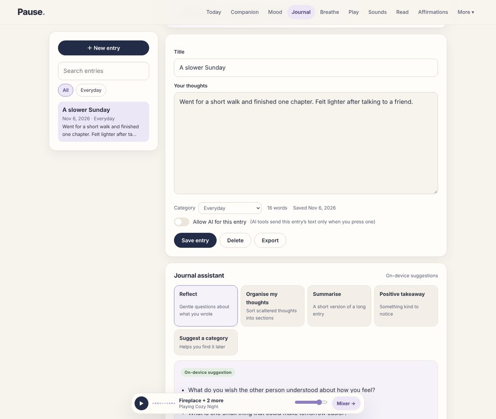
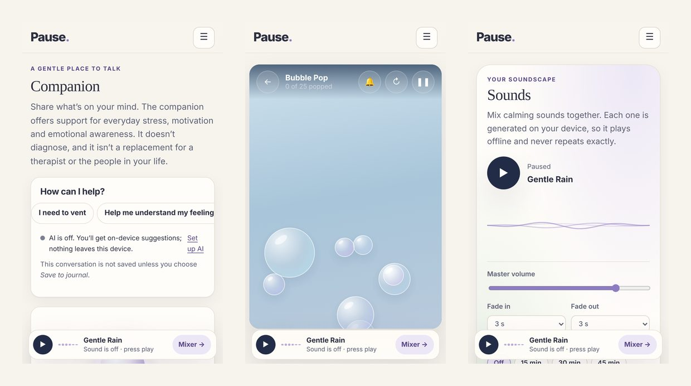
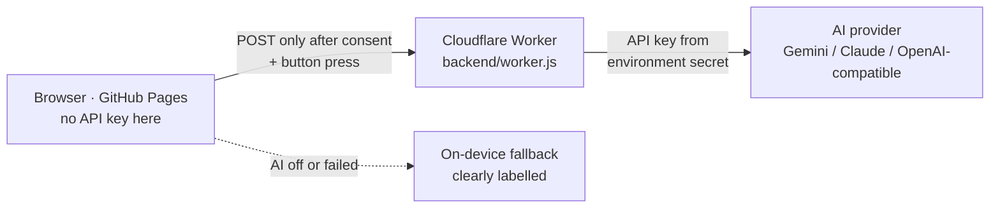

<div align="center">

# Pause 🌙

### A little space to breathe, play, reflect and begin again.

A calm, private, local-first wellness web app with an optional AI companion, guided breathing, quiet games and a generative sound mixer.

[**Live demo →**](https://nbhumika07.github.io/pause/)

<sub>The live demo runs without AI (on-device suggestions only). AI features run locally. See <a href="#set-up-ai-optional">Set up AI</a>.</sub>




</div>

---

## Contents

- [Why Pause](#why-pause)
- [Screenshots](#screenshots)
- [Features](#features)
- [How the AI works](#how-the-ai-works)
- [Tech stack](#tech-stack)
- [Project structure](#project-structure)
- [Run it locally](#run-it-locally)
- [Set up AI (optional)](#set-up-ai-optional)
- [Deploy](#deploy)
- [Privacy and safety](#privacy-and-safety)
- [Accessibility](#accessibility)
- [Limitations and next steps](#limitations-and-next-steps)

## Why Pause

Most wellness apps ask for an account, track you, and push streaks and notifications. Pause does the opposite:

- **No account, no tracking.** Everything you write stays in your browser.
- **No pressure.** No streaks, scores or guilt. You can stop any activity at any time.
- **AI is optional and honest.** It only runs when you switch it on, agree to a clear consent notice, and press an AI button. Every result is labelled as AI or on-device.
- **Works offline.** Breathing, games, sounds, journal and mood tracking all work without internet.

## Screenshots

| Today dashboard | Sound mixer |
|---|---|
|  |  |
| **Games hub** | **Breathing for how you feel** |
|  |  |
| **Mood history** | **Journal assistant** |
|  |  |

<p align="center"></p>

## Features

### 🌤 Today
A gentle dashboard with today's check-in, a daily affirmation, activity suggestions you can filter by time available, a quick way into the companion, your week's mood, recent journal entries, and activity and reading progress.

### 💬 Companion (AI, optional)
A conversation companion with six modes: *vent*, *understand my feelings*, *motivation*, *calm down*, *just listen*, and *give me an activity*. It can suggest a real in-app activity as a card you can start. It doesn't diagnose or claim to be a therapist, and in long conversations it gently encourages talking to people you trust. Conversations aren't saved unless you choose "Save to journal".

### 🌡 Mood check-ins and insights
- Choose an overall feeling, emotion tags, notes, and "Today I…" factors such as sleep, time outside, or a long study day.
- See your history as week and 30-day line charts and a month calendar. All charts are accessible SVG with tooltips and a table view.
- On-device insights show possible patterns, always phrased as "you might notice", never as causes.
- An optional AI weekly reflection. Your written notes are only sent if you tick a box.

### 📓 Journal
Private entries with daily prompts, search, categories and draft autosave. Five assistant tools: **reflect** (gentle questions), **organise my thoughts** into sections, **summarise**, **positive takeaway**, and **suggest a category**. AI only reads an entry if you switch on "Allow AI" for that entry. Otherwise the tools run on your device.

### 🫁 Breathe
- Five patterns (longer exhale, box, even, 4·7·8, double-inhale sigh) plus your own custom timing.
- **Breathing for how you feel:** pick or describe a feeling and Pause suggests a pattern and length, with a reason.
- After each session it asks whether it helped. Future suggestions favour what worked for you and skip what didn't.
- Soft inhale and exhale sounds timed to the animation, optional chimes, background ambience, and a silent mode.

### 🎮 Take a Little Break: six quiet games
Each game has an intro, a choice of pace (Gentle, Steady or Focused), pause, resume, restart and exit, a gentle goal and a completion screen. Sound effects are optional, and every game has a reduced-motion version.

| Game | What's special |
|---|---|
| Catch the Fireflies | Stars, swaying grass, sparks; keyboard friendly |
| Bubble Pop | Bubbles rise and burst; missed ones just float away |
| Fluid Art | Palettes, brush, flow, 2/4/6-way mirror mode, save as image |
| Bubble Wrap | Press and drag to pop a whole row |
| Five Senses | 5-4-3-2-1 grounding with optional notes saved to your journal |
| Alphabet Categories | Letter and category rounds; your words shown at the end |

There's also a game of the day, recently played games, favourites, a private play journal, and six short **guided moments** (two-minute start, thought dump, gentle reset, three small things, body scan, reach out).

### 🎧 Sounds
- **13 soundscapes generated in your browser:** rain, distant thunder, ocean, forest, wind, crickets, fireplace, stream, white, pink and brown noise, deep focus, and soft tones.
- Layer several at once with separate volumes and smooth crossfades.
- Adjustable fade-in and fade-out, a sleep timer, and a live visualiser.
- Six presets, plus your own saved mixes, favourites and recently played.

### 📚 Read, ✨ Affirmations, 📝 Therapy notes
- **Read:** 37 short articles with smart search, "what do you need" categories, reading time, bookmarks, a distraction-free reader, and optional summaries.
- **Affirmations:** 42 realistic affirmations in 8 categories, a daily pick, ones matched to your mood, AI-written ones, and your own words.
- **Therapy notes:** a structured note to bring to a counsellor. A brain-dump box sorts your words under the headings.

## How the AI works



- **No key in the browser.** Anything on GitHub Pages is public, so the key lives only in the Worker as an encrypted secret.
- **Prompts on the server.** System prompts and safety rules are written on the server, so the browser can't change them.
- **Origin allow-list.** Only your site's address can call the backend. Request size and request rate are limited too.
- **No storage.** The backend doesn't store or log anything users write.
- **Two-layer safety check.** Crisis language is detected on the device first and shows real support options. The backend checks again and switches the AI to short, safety-focused replies.
- **Graceful fallback.** Every AI feature has an on-device version, so the app never breaks when AI is off, offline or out of quota.

## Tech stack

| Area | Choice | Why |
|---|---|---|
| Front end | HTML, CSS, vanilla JavaScript | No framework or build step; runs directly on GitHub Pages |
| Storage | IndexedDB with a localStorage fallback | Private, on-device, survives reloads; export and import as JSON |
| Audio | Web Audio API: one AudioContext, buses, BiquadFilters, StereoPanner, Convolver reverb, DynamicsCompressor limiter, AnalyserNode | Rich generated sound with no audio files |
| Charts | Hand-built SVG | Accessible, small and themeable |
| Offline | Service worker and web app manifest | Installable, works without internet |
| Backend | Cloudflare Worker (serverless) | Free tier; keeps the API key secret |
| AI | Any OpenAI-compatible API (e.g. Google Gemini) or Anthropic Claude | Switch providers with one setting |

## Project structure

```text
pause/
├── index.html                 # Entry point
├── manifest.webmanifest       # Install as an app
├── sw.js                      # Offline cache (never caches AI requests)
├── .nojekyll                  # Serve files as-is on GitHub Pages
├── assets/
│   ├── css/styles.css         # Design system: light and night themes, responsive
│   ├── icon.svg, icon-*.png   # App icons
│   └── js/
│       ├── config.js          # Public settings: backend address only, never secrets
│       ├── core.js            # Helpers, preferences, toasts, dialogs, router
│       ├── storage.js         # IndexedDB with fallback, export/import
│       ├── catalog.js         # Feelings, goals, activities, affirmations, prompts
│       ├── safety.js          # On-device crisis-language check and support card
│       ├── ai.js              # AI service layer, consent, on-device fallbacks
│       ├── recommend.js       # Personalised suggestions (on-device)
│       ├── charts.js          # Mood charts
│       ├── games.js           # The six games (modules)
│       ├── audio/
│       │   ├── engine.js      # AudioContext, buses, limiter, reverb, fades, sound effects
│       │   ├── soundscapes.js # 13 generated soundscapes and 6 presets
│       │   └── mixer.js       # Multi-layer mixer, saved mixes, sleep timer, player bar
│       ├── pages/             # One file per screen
│       └── app.js             # App shell and navigation
├── data/                      # Reading library content
├── docs/screenshots/          # Images used in this README
└── backend/
    ├── worker.js              # Serverless AI backend
    ├── wrangler.toml          # Worker settings (no secrets)
    ├── dev-server.js          # Local server for the site and the backend
    └── .dev.vars.example      # Template for local secrets (copy to .dev.vars)
```

## Run it locally

**Just the app (no AI).** From the project folder:

```bash
python -m http.server 8000
```

Then open <http://localhost:8000>.

**App and AI backend together** (Node.js 18 or newer):

```bash
node backend/dev-server.js
```

Then open <http://localhost:8787>. Without a key, the backend runs in **test mode**: AI answers are placeholders labelled "Test mode · not AI", so you can check the whole flow safely.

## Set up AI (optional)

1. **Get an API key.** For example, a free Google Gemini key from <https://aistudio.google.com/apikey>.
2. **Create `backend/.dev.vars`** (it's git-ignored) for local testing:

   ```ini
   PROVIDER=openai
   OPENAI_BASE_URL=https://generativelanguage.googleapis.com/v1beta/openai
   MODEL=gemini-3.5-flash-lite
   OPENAI_API_KEY=your-key-here
   ```

   Model names change over time. Check your provider's current list. To use Claude, set `PROVIDER=anthropic`, `ANTHROPIC_API_KEY` and `MODEL`.
3. **Run and test.** Start `node backend/dev-server.js`, open **Settings → AI assistance**, switch on AI, then press **Test**. It sends one small real request and shows the provider's exact error if something's wrong.

## Deploy

### Website on GitHub Pages

```bash
git add -A
git commit -m "Describe your change"
git push
```

On GitHub, open **Settings → Pages**, choose **Deploy from a branch**, then **main** and **/ (root)**, and save. The site appears at `https://<username>.github.io/<repo>/`.

> After changing files, bump `VERSION` in `sw.js` so returning visitors get the update.

### About AI on the live site

The published site is static, so **AI features are off there** and every feature uses its on-device fallback. This is intentional: GitHub Pages can't keep an API key secret, and a key in front-end code would be public. AI runs locally through `backend/dev-server.js`, with the key kept in the git-ignored `backend/.dev.vars`.

To enable AI online later, deploy `backend/worker.js` to a serverless host. It's ready for Cloudflare Workers (`npx wrangler deploy` from `backend/`, with the key added via `npx wrangler secret put`). Then set the Worker URL as `aiEndpoint` in `assets/js/config.js`.

## Privacy and safety

- Check-ins, journal entries, notes, bookmarks, affirmations and activity history are stored only in your browser (IndexedDB).
- **Settings → Your data** lets you export everything, import a backup (it merges and never deletes), or delete any type of data.
- Before anything is sent to AI, a consent notice explains exactly what's sent, where it goes and what isn't sent. Each AI feature can be switched off on its own.
- If crisis language is detected, Pause shows **112** (emergency, India), **Tele-MANAS 14416 / 1-800-891-4416** (free, 24×7) and a ready-to-send message for someone you trust.

> **Pause is a self-reflection and wellness tool. It does not diagnose, provide crisis care, or replace a qualified mental-health professional.** Service details can change; check the official [112](https://112.gov.in/) and [Tele-MANAS](https://dghs.mohfw.gov.in/national-mental-health-programme.php) pages.

## Accessibility

- Semantic HTML, a skip link, visible focus styles, and keyboard support everywhere, including the games.
- Dialogs keep focus inside them and close with Escape. Charts have table alternatives. Status messages are announced to screen readers.
- Light, night and match-device themes, built with accessible contrast in mind.
- Respects **reduced motion**, either from your device or the in-app setting. Games and animations have calmer alternatives.
- Mobile-first layouts with large touch targets.

## Limitations and next steps

- Data lives in one browser. There's no sync between devices, by design. Use export and import to move it.
- Sounds are generated in the browser. Real recordings can sound more natural: add royalty-free files in `assets/audio/` and list them under `audioAssets` in `config.js`, and Pause falls back to the generated sound if a file fails to load.
- On iPhone, web audio is muted when the ring/silent switch is on silent.
- Ideas: optional encrypted cloud backup, more languages (Hindi, Kannada), and RAG over the reading library for grounded answers.

---

<div align="center">

Built by [@nbhumika07](https://github.com/nbhumika07) · Made to make a little room for yourself 🌙

</div>
